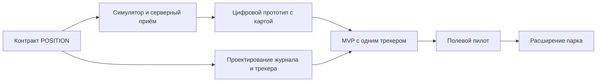

# Transport Telemetry — дорожная карта разработки и обучения

Черновик от 14 ноября 2026.

Цель проекта — разработать систему, которая получает координаты общественного транспорта, показывает пассажиру последнее пригодное измерение и даёт перевозчику данные для диагностики. Ближайший результат — один физический трекер, один сервер, веб-карта и симулятор. Собственная плата, установка на автобус и городской масштаб проходят отдельную приёмку. [Карта проекта](PROJECT_MAP.md) · [SRS, §2.2 и §8.3](SRS.md)

Дорожная карта связывает проектирование, реализацию и практическое обучение. Системные требования задаёт [SRS](SRS.md). Форматы определяют тематические ICD. Отраслевые примеры, учебные задания и критерии начала этапов предложены к обсуждению. [Точка продолжения](CHECKPOINT.md) · [Журнал решений](DECISIONS.md) · [Философия проекта](PROJECT_PHILOSOPHY.md)

## 1. Этапы и результаты

| Этап | Что должно работать | Что подтверждает готовность |
| --- | --- | --- |
| **POSITION** | Симулятор и сервер могут независимо реализовать один и тот же контракт | Согласованы поля, обмен и поведение при отказах для первого сценария. Есть эталонные байты, входные сценарии и ожидаемые результаты |
| **Цифровой прототип** | Симулятор → приём телеметрии → текущее состояние → веб-карта | Демонстрация с одним виртуальным трекером, затем с несколькими. Проверены порядок, свежесть, reconnect и смена подписки |
| **MVP с одним трекером** | Физический трекер и симулятор работают с одним сервером, журнал выгружается после восстановления связи | Интеграционные испытания на стенде, включая потерю ответа, перезапуск, отключение питания и одновременный live и архив |
| **Полевой пилот** | Трекер разрешён к установке на выбранном автобусе и наблюдаем в эксплуатации | Повторные рейсы с описанными условиями, полевой отчёт, список дефектов и согласованные действия при отказе |
| **Ограниченное развёртывание и городской масштаб** | Парк можно разворачивать, обслуживать и восстанавливать с известными пределами нагрузки | Подтверждены нагрузочный профиль, восстановление, эксплуатационные расходы и условия расширения парка |

**Календарный ориентир.** Если над проектом работает один человек по 8–12 часов в неделю, первые два месяца можно планировать под `POSITION` и цифровой прототип, месяцы 3–5 — под физический стенд и интеграцию, а подготовку и проведение первого пилота — на горизонте 6–9 месяцев. Это предварительная оценка. Пересчитать её после цифрового прототипа и первого замера на железе. Срок пилота зависит от доступа к автобусу, поставок и количества ревизий платы. [Этапы приёмки, SRS §8.3](SRS.md#83-acceptance-gates)

## 2. POSITION и вход в реализацию

**Текущий этап.** Довести контракт позиции и выдачи диапазонов до готовности для симулятора. [Контракт позиции](POSITION.md) · [Текущий вопрос](CHECKPOINT.md)

**Что довести до проверяемого контракта.**

1. Завершить контракт выдачи диапазонов. Определить коды типов, сообщение об ошибке, различие между временным отказом и исчерпанием номеров, поведение при неполном ответе. Зафиксировать ожидаемые результаты для успешной выдачи, потери ответа и перезапуска трекера. Выбор СУБД и детали EEPROM можно обсуждать отдельно по мере реализации соответствующих компонентов. [Выдача диапазонов](POSITION.md#range-allocation)
2. Согласовать открытые детали защищённого сетевого обмена для первого end-to-end сценария. Нужны совместимые байты контекста TLS Exporter, проверочные векторы и ожидаемое поведение при смене ключа и утрате серверного anti-replay-состояния. [Управление ключами](KEY_MANAGEMENT.md) · [RFC 8446, §7.5](https://www.rfc-editor.org/rfc/rfc8446.html#section-7.5) · [NIST SP 800-38C](https://csrc.nist.gov/pubs/sp/800/38/c/upd1/final)
3. Подготовить минимальную матрицу проверок `вход → ожидаемый результат`. Включить валидную позицию, перестановку событий, молчание источника, повтор запроса диапазона после потери TLS-ответа и запуск после отключения питания. Для сетевой интеграции добавить контрольный защищённый пакет и проверку, что при утрате replay-состояния старая эпоха закрывается. [Сценарии SRS, §8.2](SRS.md#82-mandatory-named-acceptance-fixtures)

**Предлагаемая граница начала реализации.** Сначала завершить проработку `POSITION` для согласованного первого сценария. Сразу после этого начать цифровой прототип с **локального генератора симулятора**, параллельно с проектированием архива, платы и остальных интерфейсов. Для генератора достаточно согласованной семантики полей, эталонной записи и воспроизводимой трассы. Подключение к защищённому UDP требует готового контракта обмена ключами и выдачи диапазонов, а подключение веб-карты — согласованного клиентского контракта. Эти зависимости стоит проверять отдельно при переходе к каждому шагу. [Стратегия SRS, §11](SRS.md#11-project-development-strategy)

**Изучить к этапу.** Двоичное представление, порядок байтов, знаковые координаты, границы сообщений в TCP/TLS, тайм-ауты и повтор операции. Лабораторная работа — по спецификации вручную построить одну запись, затем сравнить её с выводом программного кодировщика. На собственном стенде посмотреть, как UDP и TCP ведут себя при потере и дроблении данных. [Kurose и Ross, Wireshark Labs](https://gaia.cs.umass.edu/kurose_ross/wireshark.php) · [RFC 768, UDP](https://www.rfc-editor.org/rfc/rfc768.html) · [RFC 9293, TCP](https://www.rfc-editor.org/rfc/rfc9293.html) · [RFC 8446, TLS 1.3](https://www.rfc-editor.org/rfc/rfc8446.html)

## 3. Цифровой прототип

**Симулятор и приём.** Взять один короткий маршрут, фиксированное начальное время и заданный темп. Сгенерировать, например, 60 позиций с шагом 1 секунда. Хранить параметры сценария и ожидаемый результат, чтобы воспроизводить прогон. Добавить управляемые потери, задержки, дубликаты и перестановку входных событий. Потеря или повтор в тесте моделируется на входе приёмника или транспортном стенде. Обычный симулятор отправляет live по тем же правилам, что и трекер. [Симулятор, SRS-FR-033 и FR-034](SRS.md#47-simulation--diagnostics) · [Live-доставка](POSITION.md#live-доставка)

**Текущее состояние и карта.** Реализовать один сквозной сценарий от приёма до обновления маркера. При входе `101 → 103 → 102` позиция с номером `103` остаётся текущей. Карта показывает время измерения и состояние устаревания при молчании трекера. Порог отображения в рабочем ICD открыт. Для клиентского контракта определить семантику полного и частичного снимка, смены подписки, отмены старого запроса и восстановления после reconnect. Проверить, что поздний ответ от прежней подписки не изменяет карту. [Live-доставка](POSITION.md#live-доставка) · [Сценарии SNAP и REC, SRS §8.2](SRS.md#82-mandatory-named-acceptance-fixtures)

**Диагностика.** Сначала проверить логи приёмника и состояние карты по известному входному набору. После согласования формата сводок добавить два независимых минутных отчёта TX и RX. Прогнать минуту, в которой отчёт TX потерялся, а RX был сформирован. Сервер может сообщить собственное число учтённых пакетов, доля потерь при этом остаётся неизвестной. [TX_STATS и RX_STATS](TX_RX_STATS.md)

**Хранение и параллельная обработка.** Освоить транзакции и ограничения уникальности на примере выдачи диапазонов. Выдача сохраняет верхнюю границу и результат запроса атомарно. Задача для принятия решения о хранилище — доказать на прототипе, что повтор после сохранения и потери ответа возвращает тот же результат, в том числе после обычного рестарта процесса. Для истории отдельно определить запросы, срок хранения и правила восстановления. Индексы и разделение хранения оценивать по измеренным запросам и объёму. [Выдача диапазонов](POSITION.md#range-allocation) · [ARCHIVE_TRANSFER](ARCHIVE_TRANSFER.md) · [Designing Data-Intensive Applications, 2-е изд.](https://www.oreilly.com/library/view/designing-data-intensive-applications/9781098119058/)

**Контрольная демонстрация.** Новый разработчик запускает один воспроизводимый сценарий, видит маршрут на карте, останавливает источник, наблюдает устаревание, возобновляет поток и получает актуальную точку. Отдельный тест подтверждает проверку порядка при перестановке. Если используется GeoJSON, проверить преобразование `latitudeE7/longitudeE7` в порядок «долгота, широта». Текстовое обозначение устаревания полезно вместе с цветом. [RFC 7946, §3.1.1](https://www.rfc-editor.org/rfc/rfc7946.html#section-3.1.1) · [WCAG 2.2, использование цвета](https://www.w3.org/TR/WCAG22/#use-of-color)

## 4. Физический трекер и стенд

| Задача | Что изучить | Что принести на проверку |
| --- | --- | --- |
| **GNSS и время** | Фиксация и её качество, время до первого фикса и восстановления, многолучёвость, UTC и RTC, размещение антенны | Лог холодного запуска, потери и восстановления фикса. При недостоверном GNSS или UTC трекер соблюдает правила ICD и фиксирует диагностическое состояние |
| **Модем и связь** | Сотовая регистрация, диапазоны и покрытие оператора, SIM/APN, состояние IP-сессии и повторное подключение | На выбранной сети трекер получает диапазон по TLS и отправляет live. Испытание фиксирует восстановление, объём трафика и сбои модема |
| **Память и питание** | Драйверы, конечные автоматы, watchdog, brownout, проверка записей, ресурс энергонезависимой памяти | Теряется питание до завершения записи копий диапазона. После запуска старый остаток диапазона не используется. До новой выдачи нумерованные позиции ждут, а ранее сохранённый архив доступен для выгрузки |
| **Локальный журнал и архив** | Порядок записи, проверка целостности, обработка незавершённой записи, долговременная идентичность блока, подтверждение устойчивого сохранения | После потери `ARCHIVE_ACK` повтор неизменённого блока не создаёт дублей. Архив сохраняет время исходного измерения и не меняет live-позицию. Объём потерь при отключении питания измерен |
| **Управление устройством** | Идентичность трекера, защищённое хранение ключей, регистрация и отзыв доступа, подписанное обновление и восстановление после прерывания | Для MVP — необходимые для live и архива операции. К пилоту — испытания отзыва, повторной команды и прерванного подписанного обновления по согласованному контракту |

Начать с готовых модулей на стенде. Собственная плата становится следующим результатом после проверки потребления, интерфейсов и поведения при отказах. Для ревизии платы подготовить схему, BOM, размещение антенн, тестовые точки, инструкцию первого включения и протокол измерений. При выборе носителя оценить ёмкость и ресурс по проектному профилю хранения. [Локальный журнал](POSITION_RECORD.md#storage-and-recovery) · [KEY_MANAGEMENT](KEY_MANAGEMENT.md) · [Master ICD, ICD-006](ICD.md)

**Лабораторные работы.** Сначала прочитать UART-лог GNSS и воспроизвести переход в no-fix. Затем измерить потребление при передаче модема и проверить состояние прошивки после внезапного отключения питания на низковольтном стенде. Для OTA сверить архитектуру обновления и манифеста перед определением полей собственного ICD. [Making Embedded Systems](https://www.oreilly.com/library/view/making-embedded-systems/9781098151539/) · [Документация KiCad](https://docs.kicad.org/) · [GPS.gov, стандарты сервиса GPS](https://www.gps.gov/performance-standards-specifications) · [RFC 9019](https://www.rfc-editor.org/rfc/rfc9019.html) · [RFC 9124](https://www.rfc-editor.org/rfc/rfc9124.html)

## 5. Полевой пилот и эксплуатация

**Подготовка пилота.** Вместе с перевозчиком согласовать транспорт, маршрут, место установки, питание, антенну, окно испытаний и процедуру снятия устройства. Определить, кто видит историю, как долго она нужна и какие данные можно публиковать. Для установки задать проверяемые условия по бортовому питанию, температуре, вибрации, корпусу и электромагнитной совместимости. Выбор обязательных испытаний зависит от места эксплуатации, оборудования и требований перевозчика. Отчёт лабораторного прогона фиксирует результаты конкретных проверок. [SRS, Field pilot](SRS.md#83-acceptance-gates) · [ITxPT, спецификации бортовой интеграции](https://itxpt.org/where-to-find-itxpt-specifications/)

| Что измерять | Как проверять и интерпретировать |
| --- | --- |
| **Свежесть и покрытие** | Доля времени с пригодной позицией в ожидаемых рейсах. Учитывать отсутствие GNSS, сети, остановку источника и периоды с неизвестной причиной |
| **Задержка доставки** | Измерение → применение клиентом. Время первого видимого кадра измерять отдельно. Указать погрешность часов, длительность окна, размер выборки и условия сети |
| **Восстановление связи** | От подтверждённого восстановления сети до применения новой валидной позиции на карте. Отдельно фиксировать время до завершения выгрузки журнала |
| **Целостность истории** | По известному набору событий проверить пропуски, конфликты, повторную доставку и сохранение после рестарта. Разрыв номеров сам по себе не доказывает потерю события |
| **Монтаж и обслуживание** | Сравнить несколько повторных рейсов, зарегистрировать перезапуски, проблемы питания и участки со слабым сигналом. Описать замену устройства, отзыв доступа, обновление и снятие с линии |

Проверить цели задержки и свежести из SRS с согласованной методикой. Публиковать условия рядом с результатом. При секундной дискретности `measuredAt` измерение субсекундной задержки требует отдельной временной метки события с известной погрешностью. [SRS §5.1](SRS.md#freshness-and-latency) · [Семантика времени `POSITION`](POSITION.md#measuredat)

**Эксплуатационный результат.** Есть отчёт по рейсам и инструкция, по которой другой человек может проверить состояние трекера, найти причину отсутствия свежих данных по доступным признакам и восстановить сервис. В панели наблюдения полезно связать пользовательскую свежесть с состояниями GNSS, модема, серверного приёма и очереди архива. Для производимой партии добавить серийный учёт, ревизии, процедуру регистрации ключей, тест каждого экземпляра, учёт запасов и замены. [SRE Workbook, SLO](https://sre.google/workbook/implementing-slos/) · [Google SRE, мониторинг](https://sre.google/sre-book/monitoring-distributed-systems/)

## 6. Транспортная модель и отраслевой обмен

Трекер, автобус, маршрут, конкретный рейс и остановка — отдельные сущности. Для диспетчера важны назначение транспорта, соблюдение графика и причина отсутствия наблюдений. Для пассажира — маршрут, свежесть позиции и происхождение оценки прибытия. Сначала изучить данные одного перевозчика. Загрузить остановки, трассы, рейсы и календарь, затем связать симулированный рейс с позицией. В тестах учесть разные направления, ночной рейс со временем больше `24:00:00`, объезд и позицию с неизвестным рейсом. [GTFS Schedule](https://gtfs.org/documentation/schedule/reference/) · [GTFS Realtime](https://gtfs.org/documentation/realtime/reference/) · [MIT OpenCourseWare, Public Transportation Systems](https://ocw.mit.edu/courses/1-258j-public-transportation-systems-spring-2017/)

| Отраслевой пример | Что применить в проекте |
| --- | --- |
| **Астана, City Transportation Systems.** В публикации CTS показаны движение автобусов на карте и отдельный прогноз на остановке. Отслеживание было доступно через Avtobys, Яндекс Карты и 2GIS. [Сообщение CTS](https://cts.gov.kz/ru/press-center/news/prilozheniya-dlya-otslezhivaniya-dvizheniya-marshrutov/) | Задать отдельные тесты для координаты автобуса и оценки прибытия. Когда доступна только последняя позиция, пассажир должен понимать, что именно он видит |
| **Нью-Йорк, MTA Bus Time.** Документация описывает объединение координат с маршрутами, расписанием и предыдущими наблюдениями. Для внешних клиентов есть отдельные данные о позициях, обновлениях рейсов и оповещениях. [Как работает MTA Bus Time](https://app.prod.obanyc.com/help/technology) · [Публичный GTFS Realtime](https://bustime-classic.mta.info/wiki/Developers/GTFSRt) | Хранить исходную позицию отдельно от результата привязки к рейсу. Проектировать публикацию как отдельное представление внутреннего состояния |
| **Англия, Bus Open Data Service.** Руководство DfT задаёт интервал 10–30 секунд для координат во внешнем обмене SIRI-VM по местному профилю. [Руководство DfT, Publishing location data](https://www.gov.uk/government/publications/bus-open-data-implementation-guide/bus-open-data-implementation-guide#publishing-location-data) | При интеграции выписать отдельно период измерения, период публикации, возраст данных и требования конкретного получателя |

**Учебная интеграция.** Сделать экспорт `VehiclePosition` для одного учебного маршрута и проверить статический и realtime наборы валидаторами. Сравнить время создания фида со временем измерения каждой позиции. Воспроизвести ситуацию, когда фид обновляется, а координаты внутри стареют. GTFS Realtime Best Practices рекомендуют обновлять фид минимум раз в 30 секунд, чаще при изменениях, и держать Vehicle Positions и Trip Updates моложе 90 секунд. Это рекомендации для внешнего фида. Если перевозчик работает с другой системой обмена, рассмотреть SIRI-VM для наблюдений и NeTEx для плановых данных. [GTFS Realtime Best Practices](https://gtfs.org/documentation/realtime/realtime-best-practices/#feed-publishing-general-practices) · [Валидаторы](https://gtfs.org/getting-started/validate/) · [SIRI](https://transmodel-cen.eu/index.php/siri/) · [NeTEx](https://transmodel-cen.eu/index.php/netex/)

**После MVP.** Для привязки координат к геометрии начать с ближайшего сегмента и проверить параллельные улицы, шумные измерения, разворот и объезд. Затем сравнить с методом, который учитывает последовательность наблюдений. Хранить исходные координаты и отдельно отмечать уверенность привязки. Для ETA сначала взять простую оценку по историческим временам движения и стоянкам. Проверять её на других рейсах с разделением по времени, считать MAE, p90 абсолютной ошибки и долю рейсов, где прогноз доступен. На карте отличать прогноз от расписания и измерения. [Исследовательский backlog](RESEARCH_BACKLOG.md) · [Newson и Krumm, статья и данные для map matching](https://www.microsoft.com/en-us/research/publication/hidden-markov-map-matching-noise-sparseness/) · [Hyndman и Athanasopoulos, Forecasting: Principles and Practice](https://otexts.com/fpp3/)

## 7. Масштабирование по данным испытаний

**Исходная модель.** Входной профиль и оценку числа событий взять из SRS. Чтобы оценить диск, нужно измерить фактическую запись и индексы, учесть выбранную политику сохранения, срок истории, резервные копии и репликацию. Для исходящего трафика отдельно моделировать размеры подписок, популярные маршруты и медленных клиентов. [SRS §5.2](SRS.md#scale-and-distribution)

1. **Стенд и первая нагрузка.** Увеличивать число источников по ступеням из SRS. Для каждого прогона собирать задержки, свежесть на карте, ошибки, CPU, RAM, диск и сеть. При увеличении нагрузки обосновывать следующее изменение измеренным узким местом.
2. **Смешанные сценарии.** Прогнать длительную номинальную нагрузку, кратковременный пик, массовое переподключение и загрузку архива одновременно с live. Проверить ограниченность очередей, восстановление подписок и сохранение монотонного текущего состояния. Размер backlog брать из сценария нагрузки SRS. Число одновременных выгрузок задаётся отдельно.
3. **Операционная готовность.** Настроить воспроизводимую сборку, прогон контрактных тестов при изменениях и учёт версий сервера и прошивки. Проверить восстановление из резервной копии, измерить время восстановления и возможную потерю данных, повторить откат релиза в тестовой среде. Установить пороги и ответственность за реакцию на инцидент вместе с оператором. Оценить стоимость устройств, SIM, исторического хранения, картографической инфраструктуры и обслуживания.

Очередь, отдельный кеш, специализированное хранилище или кластер рассматриваются после определения конкретного ограничения. Для каждого кандидата сравнить результат нагрузочного и отказного прогона, операционную стоимость и сложность восстановления. Выбор языка, СУБД, модема и среды развёртывания остаётся отдельным инженерным решением. При использовании публичных тайлов OpenStreetMap проверить политику выбранного сервиса, ограничения нагрузки и атрибуцию. [SRS §5.2](SRS.md#scale-and-distribution) · [OSMF Tile Usage Policy](https://operations.osmfoundation.org/policies/tiles/)

## 8. Стандарты и документы, которые понадобятся на разных этапах

| Документ | Зачем читать и где применять |
| --- | --- |
| [ISO/IEC/IEEE 29148:2018](https://www.iso.org/standard/72089.html) | Инженерия требований. Использовать при уточнении границ SRS и связи требований с этапами проверки |
| [RFC 8446](https://www.rfc-editor.org/rfc/rfc8446.html), [RFC 3610](https://www.rfc-editor.org/rfc/rfc3610.html), [NIST SP 800-38C](https://csrc.nist.gov/pubs/sp/800/38/c/upd1/final) | TLS 1.3, экспорт ключевого материала и режим CCM. При подготовке векторов и реализации проверять соответствие профилю из ICD |
| [GTFS Schedule](https://gtfs.org/documentation/schedule/reference/), [GTFS Realtime](https://gtfs.org/documentation/realtime/reference/), [SIRI](https://transmodel-cen.eu/index.php/siri/), [NeTEx](https://transmodel-cen.eu/index.php/netex/) | Модели и форматы для обмена с перевозчиком, агрегатором или пассажирским приложением. Выбрать профиль по потребителю данных |
| [ITxPT S01/S02/S03](https://itxpt.org/where-to-find-itxpt-specifications/) | Монтаж и аппаратные интерфейсы, бортовые сервисы и интеграция с серверными системами. Сверять, когда устройство должно взаимодействовать с инфраструктурой перевозчика |
| [ISO 16750-2:2023](https://www.iso.org/standard/76119.html), [ISO 7637-2:2011](https://www.iso.org/standard/50925.html) | Электрические нагрузки и переходные помехи по цепям питания. Подготовить план испытаний под бортсеть, место установки и класс оборудования |
| [UN Regulation No. 10](https://eur-lex.europa.eu/eli/reg/2022/2263/oj/eng), [ISO/SAE 21434:2021](https://www.iso.org/standard/70918.html) | ЭМС и инженерия автомобильной кибербезопасности. Применимость и требуемую редакцию выяснять с оператором и специалистом по допуску для выбранной юрисдикции |
| [WCAG 2.2](https://www.w3.org/TR/WCAG22/) | При проектировании веб-карты проверить различимость состояний, читаемость и доступность управления |

При подготовке к пилоту полезно вести матрицу из четырёх столбцов — требование, источник, применимость, способ проверки. Разнести по строкам собственные проектные цели, договорные требования перевозчика, отраслевые рекомендации и обязательные нормы. Тогда показатели внешнего фида, внутренней телеметрии и допуска оборудования можно согласовывать независимо.

## 9. Книги, курсы и практические материалы

Читать выборочно перед соответствующей задачей. Результат чтения — выполненная лабораторная работа, объяснённый тест или обоснованное проектное решение.

| Когда | Книга или материал | Что забрать в проект |
| --- | --- | --- |
| Если нужно освоить основы программирования | Harvard CS50x. [Открытый курс](https://cs50.harvard.edu/x/) | Пройти блоки по C, массивам и памяти, затем написать разбор одной бинарной записи с тестом длины и порядка байтов |
| До сетевого прототипа | James Kurose, Keith Ross — *Computer Networking: A Top-Down Approach*. [Открытые лабораторные](https://gaia.cs.umass.edu/kurose_ross/wireshark.php) | Объяснить трассу UDP, TCP и TLS, воспроизвести потерю связи и неполное чтение |
| При первом серверном прогоне | Remzi и Andrea Arpaci-Dusseau — *Operating Systems: Three Easy Pieces*. [Открытая книга](https://pages.cs.wisc.edu/~remzi/OSTEP/) | Разобраться, какие данные теряются при остановке процесса, как работают ввод-вывод и конкурентный доступ |
| При работе с выдачей и архивом | Martin Kleppmann, Chris Riccomini — *Designing Data-Intensive Applications*, 2-е изд. [Издатель](https://www.oreilly.com/library/view/designing-data-intensive-applications/9781098119058/) | Спроектировать атомарную выдачу, идемпотентную архивную запись и тест восстановления |
| Перед прошивкой и первым запуском платы | Elecia White — *Making Embedded Systems*, 2-е изд. [Издатель](https://www.oreilly.com/library/view/making-embedded-systems/9781098151539/) · [Материалы автора](https://github.com/eleciawhite/making-embedded-systems) | Разбить прошивку на состояния, подготовить порядок первого включения и выбрать точки наблюдения |
| Перед схемой питания | Paul Horowitz, Winfield Hill — *The Art of Electronics*, 3-е изд. [Сайт авторов](https://artofelectronics.net/) | Прочитать про стабилизацию, преобразование питания и измерения. Снять осциллограмму просадки при передаче модема |
| При испытании GNSS | Peter Teunissen, Oliver Montenbruck, ред. — *Springer Handbook of Global Navigation Satellite Systems*. [Издатель](https://link.springer.com/book/10.1007/978-3-319-42928-1) | Разобрать время, источники ошибок и многолучёвость. Описать, где номинальная точность кодирования расходится с точностью наблюдения |
| Перед моделью маршрутов и диспетчеризацией | Vukan Vuchic — *Urban Transit Systems and Technology*. [Издатель](https://www.wiley.com/en-us/urban-transit-systems-and-technology-p-9780470168066) · [Курс MIT](https://ocw.mit.edu/courses/1-258j-public-transportation-systems-spring-2017/) | Различить маршрут, рейс, график и интервал движения. Выбрать три решения диспетчера и описать необходимые данные |
| При анализе рейсов | TCRP Report 113 — *Using Archived AVL-APC Data to Improve Transit Performance and Management*. [National Academies Press](https://www.nationalacademies.org/publications/13907) | Использовать архив для оценки разброса времени поездки по участкам. Указать покрытие выборки и ограничения интерпретации |
| Перед пилотом и эксплуатацией | Google — *The Site Reliability Workbook*. [Открытая книга](https://sre.google/workbook/table-of-contents/) | Определить измеряемую свежесть сервиса, провести учебный инцидент и зафиксировать время восстановления |
| При исследовании ETA | Rob Hyndman, George Athanasopoulos — *Forecasting: Principles and Practice*, 3-е изд. [Открытая книга](https://otexts.com/fpp3/) | Сделать базовую модель, проверять на будущих по отношению к обучению рейсах и оценивать крупные ошибки |

Если знаний пока мало, начать с четырёх небольших работ. Написать и проверить кодировщик одной записи, прочитать локальную сетевую трассу, разобрать GNSS-лог с пропаданием фикса и нанести маршрут с остановками в учебном GIS. Нужные основы программирования, отладки, ОС и координатных систем изучаются по мере выполнения. [Wireshark Labs](https://gaia.cs.umass.edu/kurose_ross/wireshark.php) · [Учебник QGIS](https://docs.qgis.org/latest/en/docs/training_manual/)

## 10. Ближайшие задачи

1. Открыть [CHECKPOINT](CHECKPOINT.md) и согласовать текущий вопрос по контракту позиции.
2. Выписать открытые детали `POSITION`, которые нужны для первого локального сценария и последующего защищённого прогона. Для каждого сценария определить проверяемый результат.
3. После доведения `POSITION` до согласованного состояния начать симулятор с одного маршрута и воспроизводимого набора позиций. После этого по отдельным контрактам подключать приём, карту, журнал и физический трекер.
